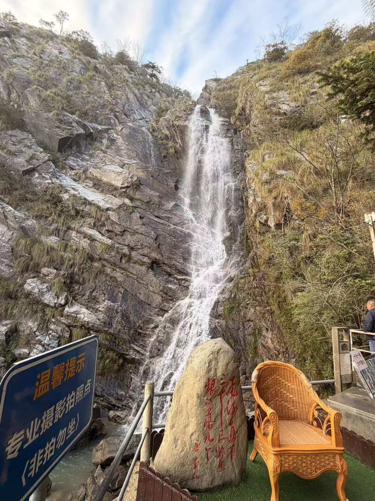

# 2026-11-14｜九江、庐山与对 AI 未来的担忧：原始素材

记录日期：2026-11-14（北京时间，来自本次聊天）。
保存日期：2026-11-15。
事件日期：原文使用“这两天”“昨天”等相对时间，旅行和通话的具体日期尚未单独确认。

> 编辑说明：下面的口述和作者补充逐字保留，包含转写错误、听闻、个人感受与未经证实的推测，不能把全部内容当成已经核实的事实。整理后的正文单独保存。

## 20:45｜原始口述与当时的附件标记

````text
ok，我们开始这几日的随笔：&#x20;
这两天来九江玩了，然后九江一开始我以为是九江王阴部的九江，后来网上查了一下，九江九江目前的九江市的话，是当年九江郡的一个边缘吧，边界其实九江郡在当时是非常大的，然后并不是我心里意义上的九江。但是呢，嗯，这座城市是之前唐代诗人白居易的当江州司马的时候任职的城市，然后这里面有很多琵琶行的演素，像浔阳江头夜送客，枫叶荻花秋瑟瑟。然后也有自己的琵琶亭，然后也有自己的琵琶文艺。嗯，我觉得这个城市在这一点，那个旅游业上可能是发展得还是不错的，在一些有名的地方上去深入的推广啊，相关文化在文化上其实我觉得很好。然后，庐山的话，过两天会去庐山，有一首诗叫望庐山瀑布。比较明确的一首诗叫日照香炉生紫烟啊，不是飞流直下三千尺，疑是银河落九天，这首诗很有意思过两天，明天会去山上去看看，但是这两天下雨了，下雨的话也不会影响我进山，我认为不惧风雨，童话说雨后会有一道彩虹。今天明确确认英嗯英伟达的黄仁勋离职了，然后这件事情的话，其实我很早就有预料，嗯但是一直还是无法接受的。其实其实马斯克英伟达和黄仁勋还有特朗普在近期的一个策略，其实是亲中的，他们是极大地扩大了美国的利益，然后和中国进行一些贸易往来。但是前段时间由于中期选举的一个失败，导致他们开始对英伟达下手。英伟达下手完毕以后，可能下一个就是黄仁勋。然后，前段时间也思考ChatGPT马上和他告别了。其实，我觉得open. A可能也会顶着巨大的压力，然后去封禁中国用户，从而符合当地政府的一个用户策略。嗯，可能未来的话，中国的老百姓就无法再使用ChatGPT和cloud code了。那Cloudco已经完全不能使用了。Open I应该也快了，其实我个人理解，黄仁勋应该是一种政治，政治上的一个问题是国家安全。其实他这个秘密很久之前就被发现了，只是说为什么要报，到现在才捅出来，其实我觉得这是美国政府的一个惯用伎俩，他们就是喜欢，就是发现一个秘密，他一先给你压着，在关键的时刻捅你一刀，让他的利益最大化，让你的利益最小。之前有人说珍珠港的时候，美国也知道，但是给了一个美国开战的一个理由和借口，他们不顾美国大兵的生死，家族美国的。很多家族嘛，美国这个公国家就是由很多资本的家族控制的美联储建立美联储的那几个大家族，像庞然大物一样，马斯克和黄仁勋的力量还是太小了。一代枭雄陨落，行业巨头。\
因为之前听说热气球事件让美国导弹击落的事情，其实我觉得本地有些人可能会也也有相当的一些策略去做的。你像黄仁勋的那个出轨的对象，也不好猜测，只是一个思考的一个方向，我觉得非常有可能。

昨天喝酒了，我给他打了个电话，聊了三四个小时，晚上睡觉了，但电话没挂。我俩总共开了12多个小时，这是电话，时间挺长的，不知道第二天是他主动挂了，还是怎么回事儿，反正我是没挂\
感觉他对我有一点意思，但不多，我对他的热情肯定很多。哎，算了，既然这样，还是告诉自己不要舔了，不然的话，又像以前那样竹篮打水一场空

庐山，景区不让进。进入景区还要人车分离。\
原因是门票设置在了下方。整个大区域就是景区 160 相当于开路畅行。感觉有点拦路打劫的意思。感觉这个地方是一个城镇，不是南京那种景点区。不合理。上来以后公交车七天畅行，但是很贵。

庐山这边有个比较抽象的，他们的公交7天70块钱，说是7天畅行，谁能玩？谁他妈能玩7天呀？顶多一两天血赚，他们到各个站，他不停需要我主动说才停，按理说正常情况下，他每到一个站都会停一下。你不管哪个景点，你哪个景点肯定都有人要下去，他们这里问有人要下吗？我说，我说我要下，他说要主动说。我靠，谁家旅游景点要求游客主动下车？我都不知道这个地方是什么地方
最后： 就这个小水花，李白真的会疑是银河落九天吗？？？？后来才知道，庐山风景区的瀑布，不是李白的瀑布！！！如果想看瀑布，最好的地方应该是黄果树瀑布！！！


<image name=[Image #1] path="/var/folders/7y/rgk0p1hs5n72ybx0c3z_f1sm0000gn/T/codex-clipboard-ca3f175f-f5c7-433b-b412-4b219be74278.jpg">
</image>
````

## 20:47｜瀑布名称补充

助手当时的问题：照片里的瀑布具体叫什么名字（例如大口瀑布、三叠泉，或其他）？如果不记得也没关系，我会先写成“眼前这道瀑布”，不凭照片确定地点。

作者原话：

````text
大口瀑布。三叠泉更小！
````

## 20:57｜希望深入讨论历史、旅游市场与 AI 未来的补充原话

````text
嗯，这里我觉得还要深的表达。我觉得表达比较浅了，现在。就是表达一下我对九江这个城市的一些看法吧。然后黄仁新这一段，你能不能去网上找一下，就是主要表达我对未来两年，就在特朗普下台之前，之前的这两年可能国际形势不太好。下台之后呢，他们可能又像拜登政府一样，就开始对中国去更深刻的一个打压。到时候 OpenAI 为了保全公司，也是不可避免地要进行站队嘛，很有可能会步入 Cloud的后尘，这个是非常有可能的。所以这是我们目前非常担忧的一个问题。然后你可以基于全网的一些信息搜集，可以再深刻地讨论一下吗？还有九江这一段的话，你觉得还有没有要讨论的空间？不要只基于我描述的，要基于真实的历史和市场。你像我住的这个地方，是李住的，以前故居很近的，这附近还有徐向前元帅以前的故居，很多毛主席的故居，邓小平同志的故居等，它有这些的红色历史。

````

## 20:58｜旧居人物补充

助手当时的问题：你提到住处附近那处旧居，具体是哪位人物的？“李住的”可能是语音转写，我先不擅自补名字。

作者原话：

````text
朱德，徐向前，周恩来，毛主席，邓小平同志。
````

## 附件与整理稿入口（编辑信息）

照片原文件已复制到附件目录，未裁剪或修改。作者确认照片为大口瀑布；“三叠泉更小”保留为本次所见感受，不推导两处瀑布的常态规模。



- [《九江》初稿](../02-正文/九江.md)
- [《担心有一天用不上》初稿](../02-正文/担心有一天用不上.md)

两篇于 2026-11-15 获作者认可并要求保存，仍为初稿。原始口述中的电话与感情片段仅保留在这里，本轮未另立正文，也未与已有重逢篇的人物自行对应。事实辨析、采用依据和后续修订事项见两篇的写作 Spec。
